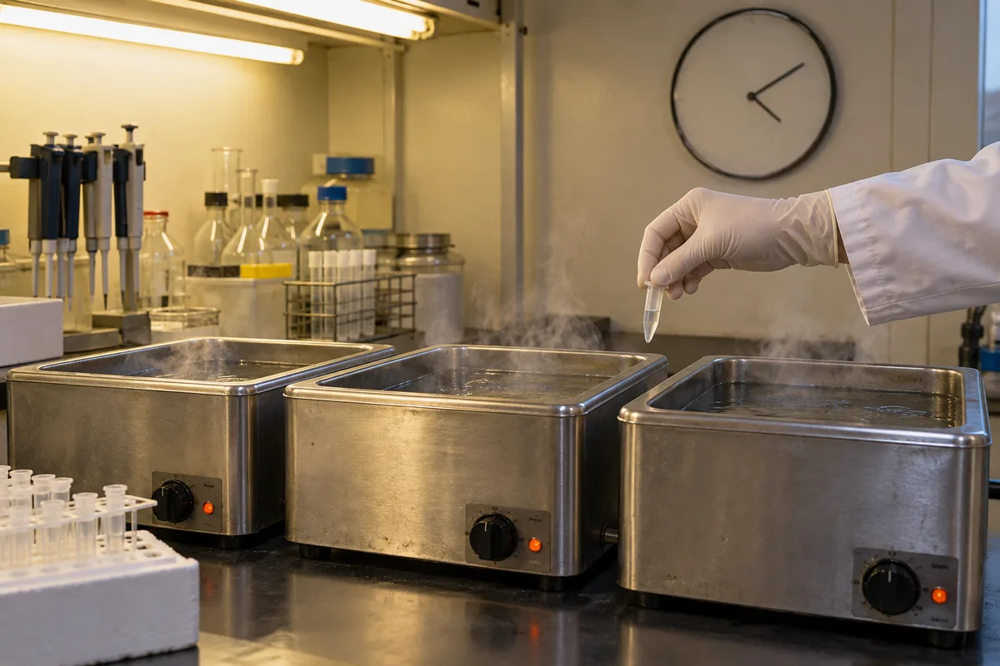
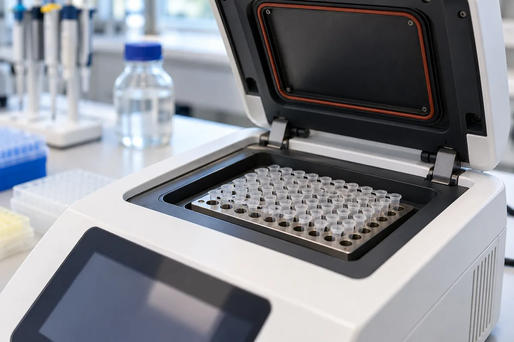
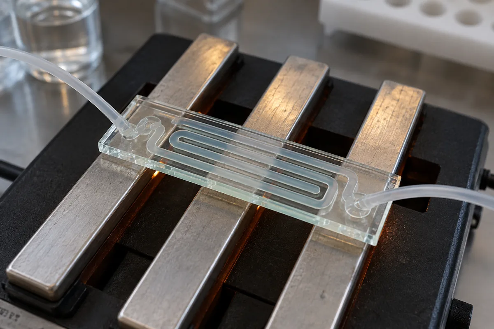
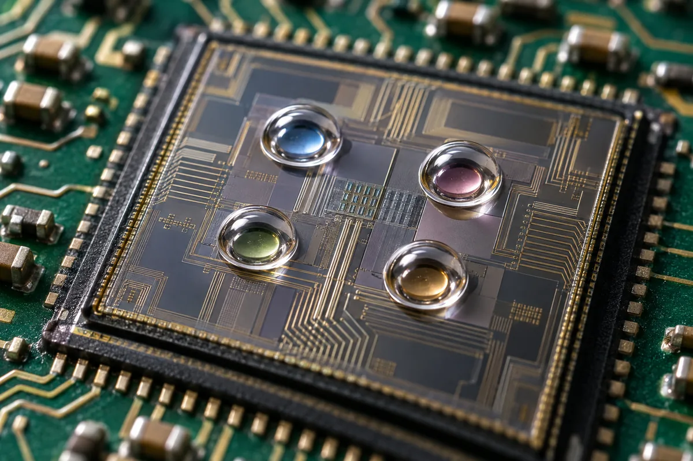
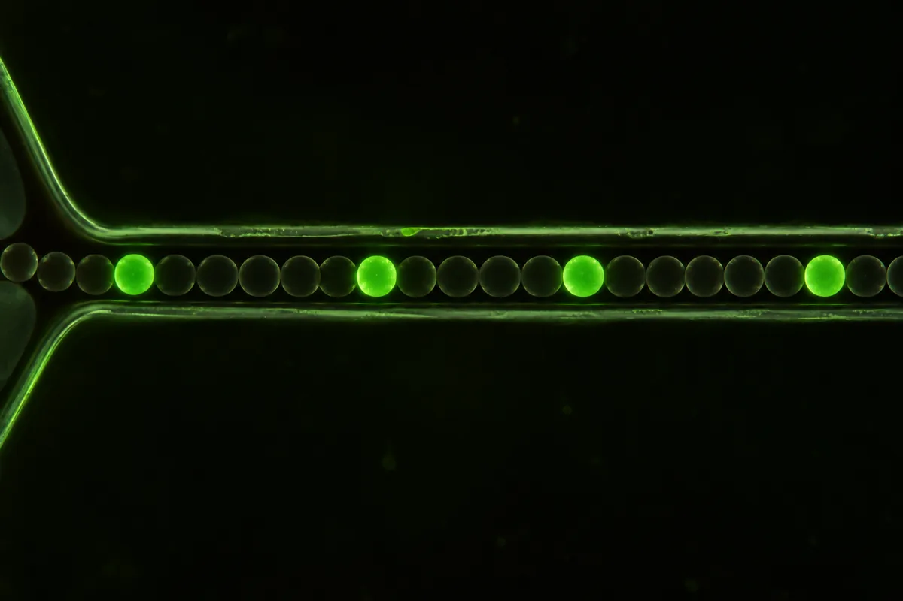
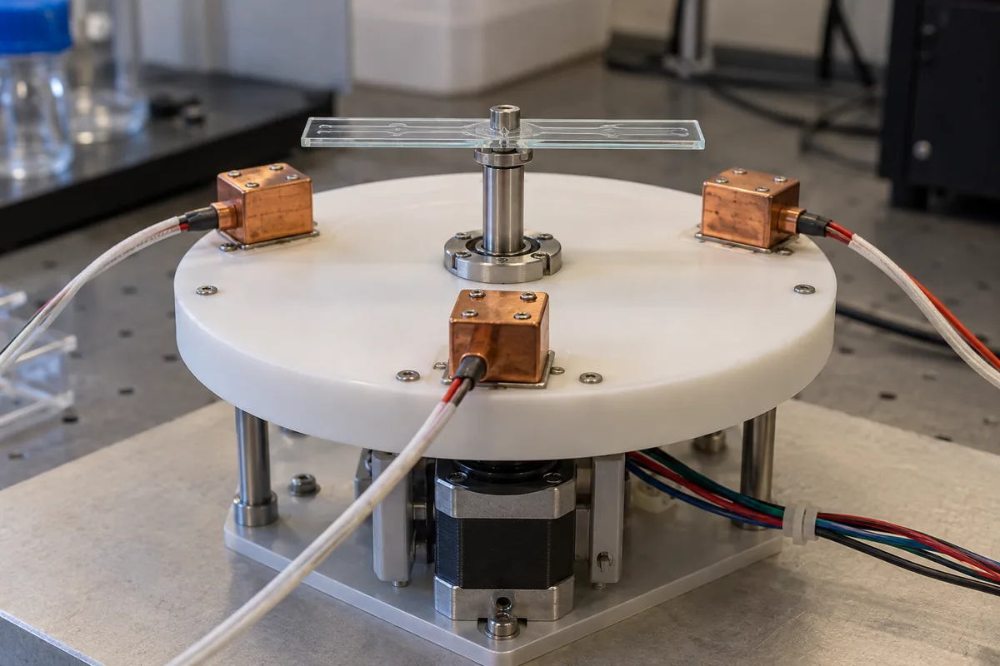

# L07 — The polymerase chain reaction (PCR)

PCR copies one DNA region billions of times by cycling the temperature, so a trace of target becomes enough to detect — first in water baths, now on chips.

*Week 8 · 27 Oct 2026 · 60 slides*

<iframe class="anim" src="../../shared/biosensor-anatomy.html?focus=recognizer" loading="lazy" title="Biosensor anatomy"></iframe>

??? info "Slide map — L07, 60 pages"
    | Pages | What's on them | Section |
    |---|---|---|
    | 1–4 | Title, outline, Part I divider | — |
    | 5–7 | Replication in vivo / in vitro, nucleotide chemistry, proofreading | [§1](#1-dna-replication) |
    | 8–13, 23, 32 | PCR requirements, Mullis, the three steps, temperature profile | [§2](#2-the-pcr-cycle) |
    | 14–18 | Taq, polymerase table, prices, error rates, Pfu fidelity | [§3](#3-the-polymerase-taq-vs-pfu) |
    | 19–21 | Non-specific annealing, hot start, additives | [§4](#4-hot-start-and-additives) |
    | 22–28 | Part II, water-bath PCR | [§5](#5-water-bath-pcr) |
    | 29–31, 34 | Thermocyclers, measured temperature traces | [§6](#6-thermocyclers) |
    | 33, 35 | Gel electrophoresis, multiplex PCR | [§7](#7-gel-electrophoresis-and-multiplex-pcr) |
    | 36–40 | PCR on the chip (continuous flow) | [§8](#8-pcr-on-a-chip-continuous-flow) |
    | 41–42 | Part III, microPCR | [§9](#9-micropcr) |
    | 43–48 | Microdroplet PCR | [§10](#10-microdroplet-pcr) |
    | 49–51 | Ultrafast rotary PCR | [§11](#11-rotary-pcr) |
    | 52–54 | PacBio SMRT sequencing | [§12](#12-single-molecule-replication-pacbio-smrt) |
    | 55–59 | qPCR, LAMP, RPA, iiPCR (videos only) | [§13](#13-beyond-classic-pcr-qpcr-lamp-rpa-iipcr) |
    | 60 | Summary | — |

## 1. DNA replication

<iframe class="anim" src="anim/replication.html" loading="lazy" title="DNA replication"></iframe>

[Open full-screen ↗](anim/replication.html)

- **Replication** turns one double helix into two identical ones; a cell does this before it divides (p.5).
- Each copy keeps one old strand and gains one new strand.
- **DNA polymerase**, the copying enzyme, adds one **dNTP** (a nucleotide building block) at a time: the strand's 3′-OH attacks the dNTP's α-phosphate, a **phosphodiester bond** forms and **pyrophosphate** (PPᵢ) leaves (p.7). So strands only grow 5′→3′.
- Some polymerases **proofread**: an **exonuclease** site cuts off a wrongly added base, then the right one goes in (p.7).

!!! tip "Key takeaway"
    A polymerase can only add to a free 3′-OH — which is why PCR needs primers.

!!! note "Background (not on slides)"
    Keeping one parent strand per copy is called *semi-conservative* replication.

📎 L07 pp. 5–7

## 2. The PCR cycle

<iframe class="anim" src="anim/pcr-cycle.html" loading="lazy" title="The PCR cycle"></iframe>

[Open full-screen ↗](anim/pcr-cycle.html)

- **PCR** (Kary Mullis, 1980s; Nobel Prize in Chemistry 1993) copies a chosen DNA region in vitro (pp. 8, 12).
- Five needs: two **primers** (short strands marking the target's ends), a thermostable **polymerase**, **dNTPs**, the **template** and **temperature cycles** (p.8).
- Each cycle: **denature** (strands separate) → **anneal** (primers bind) → **extend** (the polymerase copies) (pp. 9, 13).
- Copies double every cycle — 2ⁿ after n cycles — and the two original strands survive in two of them (p.6).
- The thermocycler program on p.30: 94 °C 5:00, then 25 × (94 / 55 / 72 °C, 0:30 each), 72 °C 7:30, hold at 4 °C.

!!! tip "Key takeaway"
    Denature → anneal → extend, and the copies go 1, 2, 4, 8 … 2ⁿ.

!!! info "Slide note"
    Temperatures differ between slides: denature 94–98 °C (pp. 9, 13, 19, 26, 30), anneal ~50–68 °C (48–72 on p.13; 55 on pp. 19, 26, 30, 38, 50), extend 72 °C (68–72 on p.13, 77 on p.37). This site uses p.30. p.19 says "10⁵-fold" after 25–30 cycles; perfect doubling gives 2²⁵–2³⁰ ≈ 10⁷–10⁹. p.8's "DNC/cDNA" means DNA/cDNA.

!!! note "Background (not on slides)"
    Exact target-length products first appear in cycle 3, then dominate. Real reactions level off as reagents run out.

📎 L07 pp. 6, 8–13, 23, 30, 32

## 3. The polymerase: Taq vs Pfu

<iframe class="anim" src="anim/polymerase.html" loading="lazy" title="Taq vs Pfu"></iframe>

[Open full-screen ↗](anim/polymerase.html)

- **Taq**: a **thermostable** polymerase from *Thermus aquaticus*, a hot-spring bacterium (Chien et al., 1976). It survives PCR's heat, so it replaced the E. coli polymerase first used (p.14).
- Half-life > 2 h at 92.5 °C, 40 min at 95 °C, 9 min at 97.5 °C; optimum 75–80 °C; ~1000 bp in < 10 s at 72 °C (p.14).
- **Pfu** adds proofreading (an exonuclease), so higher **fidelity**: 1.3 vs Taq's 8.0 errors per 10⁶ bases per doubling (pp. 15, 17).
- Taq leaves 3′-dA ends (TA cloning); Pfu leaves blunt ends and costs more: NT$3,500 vs NT$500 per 500 U (pp. 15–16).
- Pfu errs least near pH 8.5–9 and 2 mM MgSO₄, more with extra dNTP; exo⁻ Pfu errs far more (p.18).

| Enzyme | Amplification size | Fidelity | Sensitivity | Product ends | Used for |
|---|---|---|---|---|---|
| Taq | ++ | + | ++ | 3′-dA | general PCR, RT-PCR, TA cloning |
| HS Taq (hot start) | +++ | + | ++++ | 3′-dA | as Taq |
| FS Taq | +++ | + | ++++ | 3′-dA | as Taq, 3× faster |
| Pfu | ++ | +++++ | +++ | blunt | high-fidelity PCR, blunt cloning |
| Taq Plus | ++++ | +++ | +++ | 3′-dA / blunt | GC-rich, repetitive templates |
| LongTaq | +++++ | +++ | ++ | 3′-dA / blunt | long templates, sequencing |
| Fusion pfu | ++++ | +++++ | ++++ | blunt | high-fidelity, long fragments |

<figure markdown="span">
  { width="1200" height="800" loading=lazy }
  <figcaption>AI-generated illustration — a hot spring like those where Thermus aquaticus lives.</figcaption>
</figure>

!!! tip "Key takeaway"
    Taq survives the heat; Pfu proofreads, so it copies more accurately.

!!! warning "Exam trap"
    Thermostable ≠ accurate. Taq has no proofreading exonuclease; that's why Pfu's error rate is about 6× lower.

!!! info "Slide note"
    The p.15 table credits Pfu with "5′-3′ Exonclease activity"; the proofreading exonuclease works 3′→5′ (Background). p.18 labels the magnesium panel "Mg+", but the axis is MgSO₄ (Mg²⁺).

📎 L07 pp. 14–18 · Source: Nucl. Acids Res. (1996) 24 (18): 3546-3551 — [find it](https://scholar.google.com/scholar?q=Nucl.+Acids+Res.+1996+24+3546)

## 4. Hot start and additives

<iframe class="anim" src="anim/hot-start.html" loading="lazy" title="Hot-start PCR"></iframe>

[Open full-screen ↗](anim/hot-start.html)

- While the tube warms up, primers stick to near-matches (**non-specific annealing**) or each other (**primer dimers**), and active polymerase extends them into junk (p.19).
- **Hot-start PCR** blocks something until the first heat step (pp. 19–20):
- an antibody on Taq · a heat-removable group on the primer's 3′ end · a THF group on each dNTP's 3′-O (off at 95 °C) · an **aptamer** (folded DNA strand) on Taq, off above 60 °C, back below 55 °C.
- Additives (p.21):

| Additive | Typical amount | What it does |
|---|---|---|
| BSA | 0.1–0.8 µg/µL | stabilizes Taq, overcomes PCR inhibitors |
| DMSO | 2–5 % v/v | keeps GC-rich strands from folding into secondary structures |
| Glycerol | 5–10 % v/v | raises the apparent primer/template concentration; helps at high temperature |
| Formamide, betaine, TMAC | varies | more yield, less non-specific priming |
| Triton X, Tween 20, Nonidet P-40 | 0.1–1 % | stabilize Taq, suppress secondary structure — but NOT SDS: 0.01 % SDS cuts Taq to ~10 % |

!!! tip "Key takeaway"
    Hot start: nothing gets extended until the first heat step.

!!! warning "Exam trap"
    SDS is a detergent too, but it kills Taq. Only non-ionic detergents help.

!!! info "Slide note"
    p.21 says DMSO is "inhibitory at ≤ 10 % v/v"; it presumably means ≥ 10 %.

📎 L07 pp. 19–21

## 5. Water-bath PCR

<iframe class="anim" src="anim/move-the-sample.html?tab=bath" loading="lazy" title="Water-bath PCR"></iframe>

[Open full-screen ↗](anim/move-the-sample.html)

- Before machines, the tube went by hand between three baths: 95 °C 5 min, 55 °C 3 min, 72 °C 5 min. 35 cycles took 8 hours (p.26).
- Three-chamber baths (3 × 1.2 L, about $1,000) put all three in one box (p.27); p.28 shows a 1987 home-made rig.
- Fixed temperatures, moving sample — the same idea as the flow chip (§8) and rotary PCR (§11).

<figure markdown="span">
  { width="1200" height="800" loading=lazy }
  <figcaption>AI-generated illustration — hand-moving a tube between three water baths.</figcaption>
</figure>

!!! tip "Key takeaway"
    Water bath: fixed temperatures, moving sample, about 8 hours for 35 cycles.

📎 L07 pp. 22–28

## 6. Thermocyclers

<iframe class="anim" src="anim/heat-in-place.html?tab=cycler" loading="lazy" title="Thermocycler"></iframe>

[Open full-screen ↗](anim/heat-in-place.html)

- A **thermocycler** heats and cools one metal block holding the tubes (96 wells, 70 µL tube; p.30) to a program: ~50 min plus ramps, against ~8 h by hand.
- The block changes temperature at every step and the sample follows late (measured traces, p.31).
- Price on the slide: about $20,000 (p.34).

| Method | What changes temperature | Volume | Numbers on the slides | Pages |
|---|---|---|---|---|
| Water baths | the sample moves between fixed baths | one tube | 35 cycles ≈ 8 h | 26–27 |
| Thermocycler | the block heats and cools | 70 µL | ~50 min program | 30–31 |
| Continuous-flow chip | the sample flows through fixed zones | channel | 95 / 72 / 55 °C, outlets at 20–40 cycles | 37–38 |
| microPCR | a tiny heater heats the drop | 1 µL | — | 42 |
| Rotary | a motor moves the chip between fixed blocks | chip | 95 / 55 / 72 °C | 50 |

<figure markdown="span">
  { width="1200" height="800" loading=lazy }
  <figcaption>AI-generated illustration — a benchtop thermocycler, lid open.</figcaption>
</figure>

!!! tip "Key takeaway"
    In a thermocycler the block itself cycles, so its heating and cooling time is part of every step.

📎 L07 pp. 29–31, 34 · Source: Diagnostics 2013, 3, 33-67 — [find it](https://scholar.google.com/scholar?q=Diagnostics+2013+3+33)

## 7. Gel electrophoresis and multiplex PCR

<iframe class="anim" src="anim/gel-multiplex.html" loading="lazy" title="Gel electrophoresis and multiplex PCR"></iframe>

[Open full-screen ↗](anim/gel-multiplex.html)

- **Gel electrophoresis** sorts PCR products by size: DNA runs from the − end toward the + electrode, and short pieces travel farthest (p.33).
- A **DNA ladder** — pieces of known size in the next lane — lets you read each band's length.
- **Multiplex PCR** puts several primer pairs in one tube; each target gives a product of its own length, so each shows up as its own band (p.35).

!!! tip "Key takeaway"
    Small pieces run far. In multiplex PCR, different lengths keep the targets apart.

!!! note "Background (not on slides)"
    DNA's phosphate backbone is negatively charged, so it moves toward +; the gel acts as a sieve that slows long pieces more.

📎 L07 pp. 32–33, 35

## 8. PCR on a chip: continuous flow

<iframe class="anim" src="anim/move-the-sample.html?tab=flow" loading="lazy" title="Continuous-flow PCR chip"></iframe>

[Open full-screen ↗](anim/move-the-sample.html)

- Three fixed temperature zones; the sample flows along one channel winding through them, one loop per cycle (p.37: 95 °C melting, 77 °C extension, 60 °C annealing).
- p.38's chip: 95 / 72 / 55 °C zones, outlets after 20, 25, 30, 35 and 40 cycles.
- Samples can follow each other, separated by air bubbles and washes (p.39). Product levels off by 35–40 cycles (p.40).

<figure markdown="span">
  { width="1200" height="800" loading=lazy }
  <figcaption>AI-generated illustration — a glass flow chip lying across three heated bars.</figcaption>
</figure>

!!! tip "Key takeaway"
    On a flow chip the number of loops is the number of cycles.

!!! note "Background (not on slides)"
    Flow speed sets the cycle time; the pass through the extension zone must last long enough to copy the product.

📎 L07 pp. 36–40 · Sources: Science 280 (5366) 1046-1048, 1998 — [find it](https://scholar.google.com/scholar?q=Science+1998+280+1046) · Nature 422, 28-29 (2003) — [find it](https://scholar.google.com/scholar?q=Nature+2003+422+28)

## 9. microPCR

<iframe class="anim" src="anim/heat-in-place.html?tab=micro" loading="lazy" title="microPCR"></iframe>

[Open full-screen ↗](anim/heat-in-place.html)

- **microPCR** runs a 1 µL drop under oil on glass, over a silicon ring that carries a heater and a temperature sensor, on a long link arm (p.42).
- That's 70× less liquid than the 70 µL tube in a thermocycler (p.30).

<figure markdown="span">
  { width="1200" height="800" loading=lazy }
  <figcaption>AI-generated illustration — microlitre drops under oil on a chip.</figcaption>
</figure>

!!! tip "Key takeaway"
    microPCR heats in place like a thermocycler, but the sample is tiny.

!!! note "Background (not on slides)"
    Less mass to heat and cool, so the sample follows the program almost at once. The oil stops the drop evaporating.

📎 L07 pp. 41–42 · Source: Mol. BioSyst., 2006, 2, 292-298 — [find it](https://scholar.google.com/scholar?q=Mol.+BioSyst.+2006+2+292)

## 10. Microdroplet PCR

<iframe class="anim" src="anim/droplets.html" loading="lazy" title="Microdroplet PCR"></iframe>

[Open full-screen ↗](anim/droplets.html)

- Splitting a sample into droplets makes rare targets visible: two bulk samples look alike, but split up, two droplets stand out (p.44).
- Oil pinches a water stream into **microdroplets**; a surfactant stops them merging (p.45).
- In bead-based **emulsion PCR**, one template plus one bead per droplet covers the bead in copies; probes and **flow cytometry** sort the beads (pp. 45–46).
- For sequencing, nucleotides released one by one (**pyrophosphorolysis**) are caught in droplets in order and read by colour (p.47).

<figure markdown="span">
  { width="1200" height="800" loading=lazy }
  <figcaption>AI-generated illustration — droplets flowing in oil; a few light up.</figcaption>
</figure>

!!! tip "Key takeaway"
    One template per droplet makes each droplet its own clean little PCR.

!!! note "Background (not on slides)"
    Counting the droplets that light up to count target molecules is called *digital PCR*.

!!! info "Slide note"
    Only p.45 carries a citation (Nature Biotechnology 2009). The bead figures (pp. 45–46) and the droplet-sequencing figure (p.47) have none of their own; p.48 is a video.

📎 L07 pp. 43–48 · Source: Nature Biotechnology 27, 1025-1031 (2009) — [find it](https://scholar.google.com/scholar?q=Nature+Biotechnology+2009+27+1025)

## 11. Rotary PCR

<iframe class="anim" src="anim/move-the-sample.html?tab=rotary" loading="lazy" title="Rotary PCR"></iframe>

[Open full-screen ↗](anim/move-the-sample.html)

- Three blocks stay at 95, 55 and 72 °C; a motor turns the microchip between them: denature → anneal → extend = 1 cycle (p.50).
- No block heats or cools; only the chip moves. The slide calls it ultrafast; p.51 shows the stage and chips.

<figure markdown="span">
  { width="1200" height="800" loading=lazy }
  <figcaption>AI-generated illustration — a rotary stage with three fixed heating blocks.</figcaption>
</figure>

!!! tip "Key takeaway"
    Rotary PCR: fixed blocks, moving chip — the water-bath idea, motorized.

📎 L07 pp. 49–51 · Source: Lab Chip, 2012, 12, 1598-1600 — [find it](https://scholar.google.com/scholar?q=Lab+Chip+2012+12+1598)

## 12. Single-molecule replication: PacBio SMRT

<iframe class="anim" src="anim/smrt.html" loading="lazy" title="SMRT sequencing"></iframe>

[Open full-screen ↗](anim/smrt.html)

- **SMRT** = single molecule, real time: one polymerase at the bottom of a tiny well, lit from below (p.53).
- Each labelled nucleotide flashes its colour as it is built in; the string of flashes is the sequence.
- One molecule is read directly, without PCR copies. Sequencing returns in L09.

!!! tip "Key takeaway"
    SMRT: one polymerase, one molecule, one flash per base.

📎 L07 pp. 52–54 (p.54 is a video)

## 13. Beyond classic PCR: qPCR, LAMP, RPA, iiPCR

<iframe class="anim" src="anim/beyond-pcr.html" loading="lazy" title="Beyond classic PCR"></iframe>

[Open full-screen ↗](anim/beyond-pcr.html)

!!! note "Background (not on slides)"
    Pages 56–59 were videos; the PDF has only the titles.

    - **qPCR**: fluorescence read every cycle; 10× more template crosses the threshold (Ct) ~3.3 cycles sooner.
    - **LAMP**: one temperature (~60–65 °C), strand-displacing polymerase, 4–6 primers.
    - **RPA**: 37–42 °C; a recombinase pushes primers into the double strand instead of heat.
    - **iiPCR**: a capillary heated from below; convection cycles the sample.

📎 L07 pp. 55–59 (titles only)

## Key vocabulary

| Term | 中文 | Meaning |
|---|---|---|
| PCR (polymerase chain reaction) | 聚合酶連鎖反應 | Copies a chosen DNA region again and again by cycling the temperature. |
| DNA polymerase | DNA 聚合酶 | Enzyme that builds a new DNA strand on a template, 5′→3′. |
| Template | 模板 | The DNA strand being copied. |
| Primer | 引子 | Short single strand that pairs with the template and gives the polymerase a 3′ end to start from. |
| dNTP | 去氧核糖核苷三磷酸 | Nucleotide building block (dATP, dCTP, dGTP, dTTP) added to the growing strand. |
| Denaturation | 變性 | Heating to ~94–98 °C so the two strands separate. |
| Annealing | 黏合（退火） | Cooling so the primers pair with their target sites. |
| Extension | 延伸 | The polymerase adds dNTPs to each primer, ~72 °C. |
| Thermostable | 耐熱 | Still working after repeated heating to ~95 °C. |
| Taq polymerase | Taq 聚合酶 | Thermostable polymerase from the hot-spring bacterium Thermus aquaticus. |
| Pfu polymerase | Pfu 聚合酶 | Thermostable polymerase with proofreading; higher fidelity than Taq. |
| Fidelity | 保真度 | How rarely a polymerase makes copying errors. |
| Proofreading | 校對 | Removing a wrongly added base before copying on. |
| Exonuclease | 核酸外切酶 | Enzyme activity that cuts nucleotides off the end of a strand. |
| Phosphodiester bond | 磷酸二酯鍵 | Covalent link between one nucleotide's 3′-O and the next one's phosphate. |
| Pyrophosphate (PPᵢ) | 焦磷酸 | The two phosphates released when a dNTP is built in. |
| Semi-conservative replication | 半保留複製 | Each new double helix keeps one parent strand. |
| Non-specific annealing | 非專一性黏合 | Primers binding to sites that only partly match (mispriming). |
| Primer dimer | 引子二聚體 | Two primers pairing with each other and being extended into junk. |
| Hot-start PCR | 熱啟動 PCR | Polymerase, primer or dNTP blocked until the first heat step. |
| Aptamer | 適體 | Folded single strand of DNA or RNA that binds a target by shape. |
| Thermocycler | 熱循環儀 | Instrument that heats and cools a metal block through a PCR program. |
| Gel electrophoresis | 凝膠電泳 | Sorting DNA by size by pulling it through a gel with an electric field. |
| DNA ladder | DNA 分子量標記 | Mix of DNA pieces of known sizes run beside the samples. |
| Multiplex PCR | 多重 PCR | Several primer pairs amplifying several targets in one tube. |
| Continuous-flow PCR | 連續流式 PCR | The sample flows through fixed temperature zones on a chip; each loop is one cycle. |
| microPCR | 微型 PCR | PCR on a ~1 µL drop over a tiny heater. |
| Microdroplet | 微液滴 | Tiny water droplet in oil that works as its own reaction. |
| Emulsion PCR | 乳化 PCR | PCR inside water-in-oil droplets, often on beads. |
| Flow cytometry | 流式細胞術 | Reading particles one by one as they pass a laser. |
| Pyrophosphorolysis | | Reverse of polymerisation: releases nucleotides from the end of a strand. |
| SMRT sequencing | 單分子即時定序 | PacBio method that watches one polymerase build in labelled bases. |
| qPCR | 即時定量 PCR | PCR read by fluorescence in every cycle (Background). |
| Isothermal amplification | 恆溫擴增 | Copying DNA at one constant temperature, e.g. LAMP, RPA (Background). |

## Check yourself

<iframe class="anim" src="anim/quiz.html" loading="lazy" title="L07 quiz"></iframe>

[Open full-screen ↗](anim/quiz.html)
